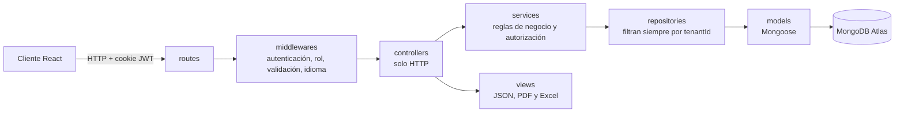

# Dashboard de Finanzas Personales

[](https://github.com/Raivel16/dashboard-finanzas-personales/actions/workflows/ci.yml)
[](https://sonarcloud.io/summary/new_code?id=Raivel16_dashboard-finanzas-personales)

Aplicación web para registrar, organizar, visualizar y analizar los ingresos y gastos personales. Es una aplicación cliente-servidor con stack **MERN** (MongoDB Atlas, Express, React y Node.js), preparada como **SaaS multiinquilino** con control de acceso por roles (RBAC).

Proyecto universitario (UC) de Ingeniería Web, desarrollado con **Spec-Driven Development** (OpenSpec): cada línea de código responde a una historia de usuario o a un requisito técnico.

## Contenido

- [Funcionalidades](#funcionalidades)
- [Tecnologías](#tecnologías)
- [Arquitectura](#arquitectura)
- [Requisitos previos](#requisitos-previos)
- [Instalación y ejecución](#instalación-y-ejecución)
- [Base de datos: MongoDB Atlas](#base-de-datos-mongodb-atlas)
- [Configuración](#configuración)
- [Datos de demostración](#datos-de-demostración)
- [Comandos](#comandos)
- [Pruebas y calidad](#pruebas-y-calidad)
- [API REST](#api-rest)
- [Seguridad y aislamiento de datos](#seguridad-y-aislamiento-de-datos)
- [Desarrollo guiado por especificaciones](#desarrollo-guiado-por-especificaciones)
- [Flujo de trabajo](#flujo-de-trabajo)
- [Documentación](#documentación)

## Funcionalidades

Las 33 historias de usuario (HU-01 a HU-33) están implementadas y cada uno de sus 132 escenarios tiene una prueba automática.

| Área | Qué permite | Historias |
|---|---|---|
| Autenticación | Registro, inicio de sesión con bloqueo tras 3 intentos, recuperación de contraseña por correo, cierre de sesión, renovación de sesión, perfil y cambio de contraseña | HU-01–03, HU-18–21 |
| Control de acceso | Roles `usuario` y `admin`; el administrador consulta en solo lectura los datos de cualquier usuario y cambia roles | HU-04, HU-05, HU-22, HU-23 |
| Categorías | Categorías propias de ingreso y gasto, con 10 predeterminadas al registrarse | HU-06, HU-24 |
| Cuentas | Efectivo, banco, tarjeta de crédito o billetera digital, en PEN, USD o EUR, con saldo actualizado | HU-07, HU-25 |
| Movimientos | Ingresos y gastos que ajustan el saldo de su cuenta en una transacción | HU-08, HU-09, HU-26, HU-27 |
| Consulta | Historial paginado con filtros por fechas, tipo, categoría y cuenta | HU-10, HU-11 |
| Dashboard | Indicadores (ingresos, gastos, balance, presupuesto usado) y gráficos de evolución y distribución por categoría | HU-12, HU-13, HU-28, HU-29 |
| Presupuestos | Presupuesto mensual general y por categoría, con seguimiento y alertas al 90 % y 100 % | HU-14, HU-15, HU-30 |
| Reportes | Exportación del historial filtrado a PDF y Excel, generada en el servidor | HU-16, HU-17, HU-31 |
| Preferencias | Español o inglés en toda la aplicación, texto grande, alto contraste y uso completo con teclado y lector de pantalla | HU-32, HU-33 |

## Tecnologías

| Capa | Tecnología | Uso |
|---|---|---|
| Base de datos | **MongoDB Atlas** (Mongoose) | Persistencia; transacciones para mantener los saldos consistentes |
| API | **Node.js 22** + **Express 5** | API REST `/api/v1` |
| Cliente | **React 19** + Vite + Tailwind CSS | Interfaz responsiva |
| Autenticación | JSON Web Tokens (`jsonwebtoken`) + bcrypt | Sesión sin estado en cookies `httpOnly` y contraseñas cifradas |
| Gráficos | Chart.js | Evolución mensual y distribución por categoría |
| Fechas | Day.js | Fechas y períodos en la zona horaria de la aplicación |
| Alertas y notificaciones | SweetAlert2 y React-Toastify | Confirmaciones y avisos de cada operación |
| Reportes | jsPDF (+ autotable) y SheetJS | PDF y Excel generados en el servidor |
| Validación | Validator.js | Mismas reglas en cliente y servidor (paquete `shared/`) |
| Identificadores | UUID v4 | Identificador público de cada recurso y `tenantId` |
| Correo | Nodemailer (SMTP, p. ej. Brevo) | Bienvenida y recuperación de contraseña |
| Calidad | ESLint, Prettier, Jest, Vitest, Testing Library, axe-core, GitHub Actions, SonarCloud | Verificación de cada cambio |

## Arquitectura

Monorepo con npm workspaces:

```text
├── client/   React (Screaming Architecture: carpetas por dominio de negocio)
├── server/   API Express (MVC por capas: Controller – Service – Repository)
├── shared/   Validaciones, constantes y mensajes que usan cliente y servidor
├── docs/     Historias de usuario, trazabilidad, cobertura, API y exposición
└── openspec/ Especificaciones (specs) y cambios de OpenSpec
```

### Servidor: Controller – Service – Repository



| Capa | Responsabilidad | Ejemplo |
|---|---|---|
| `routes/` | Define las rutas y sus middlewares | [movimientos.routes.js](server/src/routes/movimientos.routes.js) |
| `middlewares/` | Autentica el JWT, exige rol, valida el cuerpo y resuelve el idioma | [autenticacion.middleware.js](server/src/middlewares/autenticacion.middleware.js) |
| `controllers/` | Traduce HTTP a llamadas de servicio; nunca toca modelos ni repositorios | [movimiento.controller.js](server/src/controllers/movimiento.controller.js) |
| `services/` | Reglas de negocio, transacciones y autorización por rol; no conoce `req`/`res` | [movimiento.service.js](server/src/services/movimiento.service.js) |
| `repositories/` | Único código que usa los modelos; agrega el `tenantId` a toda consulta | [base.repository.js](server/src/repositories/base.repository.js) |
| `models/` | Esquemas de Mongoose, identificador UUID y plugin de inquilino | [tenant.plugin.js](server/src/models/plugins/tenant.plugin.js) |
| `views/` | Representación JSON y archivos PDF/Excel de cada recurso | [movimiento.view.js](server/src/views/movimiento.view.js) |

Ejemplo, `POST /api/v1/movimientos`:
1. `autenticar` verifica el JWT y vuelve a leer el usuario (rol vigente).
2. El controlador pasa el cuerpo al servicio.
3. El servicio valida con el esquema compartido y abre una transacción.
4. Dentro de ella comprueba que la cuenta y la categoría sean del mismo inquilino, guarda el movimiento y ajusta el saldo, que verifica con la fórmula saldo inicial + ingresos − gastos.
5. Por último calcula las alertas de presupuesto.
6. El repositorio filtra cada consulta por `tenantId`, y la vista responde `201` con `{ data, meta }`.

### Cliente: Screaming Architecture

Cada dominio (`autenticacion/`, `movimientos/`, `dashboard/`, `presupuestos/`…) tiene `components/` (presentación), `hooks/` (estado y lógica), `services/` (llamadas a la API), `pages/` y un `index.js` como API pública. Las rutas viven en `client/src/router/` y lo transversal en `client/src/shared/`. ESLint impide que un dominio importe el interior de otro.

## Requisitos previos

- **Node.js 22** (fijado en `.nvmrc`: `fnm use` o `nvm use`).
- **MongoDB como replica set**: un clúster de **MongoDB Atlas** (recomendado; ya es replica set) o MongoDB local configurado como replica set ([ver más abajo](#alternativa-mongodb-local)). Las transacciones lo exigen: sin replica set el servidor no arranca.
- Git.

## Instalación y ejecución

```sh
git clone https://github.com/Raivel16/dashboard-finanzas-personales.git
cd dashboard-finanzas-personales
npm install
cp server/.env.example server/.env   # completa MONGODB_URI y JWT_ACCESS_SECRET
npm run seed:admin -w server         # primer administrador (ver Datos de demostración)
npm run dev                          # API en :3000 y cliente en :5173
```

Abre <http://localhost:5173>. La página de inicio muestra si la API y la base de datos están disponibles.

Para producción: `npm run build` compila el cliente en `client/dist` (archivos estáticos que sirve cualquier servidor web) y `npm start -w server` inicia la API; define `NODE_ENV=production` y el SMTP en su `.env`.

## Base de datos: MongoDB Atlas

La aplicación no necesita cambios de código para usar Atlas: basta con la URI de conexión.

1. Crea una cuenta y un clúster (el nivel gratuito M0 alcanza) en <https://cloud.mongodb.com>.
2. En **Database Access** crea un usuario de base de datos con el rol *Read and write to any database*.
3. En **Network Access** agrega tu IP actual (o la del equipo que hará la demostración).
4. En **Connect → Drivers** copia la URI `mongodb+srv://…` y agrégale el nombre de la base antes de los parámetros:

   ```text
   MONGODB_URI=mongodb+srv://<usuario>:<contraseña>@<clúster>.mongodb.net/finanzas?retryWrites=true&w=majority
   ```

   Si la contraseña tiene caracteres especiales (`@`, `:`, `/`, `#`…), escríbelos codificados (`@` → `%40`).

5. Guarda esa línea en `server/.env`. Ese archivo no se versiona; la URI nunca va al repositorio.
6. Carga los datos:

   ```sh
   npm run seed:admin -w server                     # primer administrador (ADMIN_EMAIL y ADMIN_PASSWORD)
   npm run seed -w server -- --permitir-remoto      # opcional: usuarios y datos de demostración
   ```

   El seed se niega a escribir en una base que no sea local si no se pasa `--permitir-remoto`.

7. `npm run dev` y comprueba en la página de inicio que la base de datos aparece como disponible.

### Alternativa: MongoDB local

MongoDB instalado localmente arranca como servidor único y hay que convertirlo una vez en replica set de un nodo:

1. Agrega al archivo de configuración (`C:\Program Files\MongoDB\Server\<versión>\bin\mongod.cfg` en Windows, `/etc/mongod.conf` en Linux, `/opt/homebrew/etc/mongod.conf` en macOS):

   ```yaml
   replication:
     replSetName: rs0
   ```

2. Reinicia el servicio (`Restart-Service MongoDB` como administrador en Windows; `sudo systemctl restart mongod` en Linux).
3. Inicia el replica set: `mongosh --eval "rs.initiate({ _id: 'rs0', members: [{ _id: 0, host: '127.0.0.1:27017' }] })"`.
4. Usa `MONGODB_URI=mongodb://127.0.0.1:27017/finanzas?directConnection=true`.

Una base local creada antes de los identificadores UUID (RT-08) se vuelve a poblar con `npm run seed -w server`.

## Configuración

Variables de `server/.env` (plantilla en [server/.env.example](server/.env.example)). El servidor valida la configuración al arrancar y, si falta una obligatoria, se detiene indicando cuál, sin mostrar valores secretos.

| Variable | Obligatoria | Descripción |
|---|---|---|
| `MONGODB_URI` | Sí | URI de MongoDB Atlas o del replica set local |
| `JWT_ACCESS_SECRET` | Sí | Secreto de los tokens de acceso (mínimo 32 caracteres). Genera uno con `node -e "console.log(require('crypto').randomBytes(48).toString('base64url'))"` |
| `CLIENT_URL` | Sí | Origen del cliente para CORS y enlaces de correo (`http://localhost:5173` en desarrollo) |
| `NODE_ENV`, `PORT` | No | Entorno (`development`) y puerto (`3000`) |
| `APP_TIMEZONE` | No | Zona horaria de fechas y períodos (`America/Lima`) |
| `JWT_ACCESS_TTL`, `REFRESH_INACTIVITY_MIN`, `REFRESH_ABSOLUTE_DAYS`, `RESET_TOKEN_TTL_MIN` | No | Duración del token de acceso (`15m`), inactividad máxima (`30` min), vida máxima de la sesión (`7` días) y vigencia del enlace de recuperación (`30` min) |
| `SMTP_HOST`, `SMTP_PORT`, `SMTP_USER`, `SMTP_PASS`, `MAIL_FROM` | En producción | Servidor de correo. Sin `SMTP_HOST` los correos se escriben en el log, con el enlace de recuperación incluido |
| `ADMIN_EMAIL`, `ADMIN_PASSWORD` | Para `seed:admin` | Primer administrador; bórralos después de usarlos |
| `SEED_PASSWORD` | No | Contraseña de los usuarios demo (`Demo1234`) |

## Datos de demostración

`npm run seed -w server` crea datos sintéticos de 8 meses:

| Usuario | Correo | Qué muestra |
|---|---|---|
| Administración Demo | `admin@demo.finanzas.test` | Rol administrador: usuarios, roles y datos ajenos en solo lectura |
| Ana Torres | `ana.torres@demo.finanzas.test` | Cuentas en PEN y USD; presupuestos por categoría normal (Transporte), en alerta (Alimentación) y excedido (Entretenimiento) |
| Luis Quispe | `luis.quispe@demo.finanzas.test` | Cuentas en PEN y EUR; presupuesto general en alerta. Sirve para mostrar el aislamiento entre inquilinos |
| Sofía Nueva | `sofia.nueva@demo.finanzas.test` | Usuario sin movimientos (estados vacíos) |

Todos usan la contraseña `Demo1234` (o la de `SEED_PASSWORD`). Repetir el comando reemplaza solo los usuarios del dominio `demo.finanzas.test`. El seed se niega a ejecutarse con `NODE_ENV=production`.

`npm run seed:admin -w server` crea el primer administrador real con `ADMIN_EMAIL` y `ADMIN_PASSWORD`. No promueve a un usuario estándar existente; los demás administradores se promueven desde la pantalla "Administración".

## Comandos

Desde la raíz del repositorio:

| Comando | Qué hace |
|---|---|
| `npm run dev` | API (:3000) y cliente (:5173); Vite reenvía `/api` a la API |
| `npm test` | Pruebas de `shared`, `server` y `client` |
| `npm run lint` | ESLint, incluidas las fronteras entre dominios del cliente |
| `npm run build` | Compila el cliente en `client/dist` |
| `npm run format` / `format:check` | Formatea con Prettier o solo comprueba |
| `npm run cobertura` | Regenera la matriz de cobertura de escenarios |
| `npm run cobertura:comprobar` | Falla si algún escenario no tiene prueba o la matriz está desactualizada |
| `npm run seed -w server` | Datos de demostración (`-- --permitir-remoto` para Atlas) |
| `npm run seed:admin -w server` | Primer administrador |
| `npm run verificar-saldos -w server` | Comprueba que cada saldo sea saldo inicial + ingresos − gastos (solo lee) |

Una sola prueba o paquete:

```sh
npm test -w shared
npm test -w client -- tests/movimientos.test.jsx
npm test -w server -- identificadores          # Jest filtra por nombre de archivo
npm test -w server -- -t "primer administrador" # o por nombre de prueba
```

Las pruebas del servidor usan MongoDB en memoria como replica set, sin `.env` ni servicios externos. Para usar el `mongod` instalado en lugar de descargarlo, define `MONGOMS_SYSTEM_BINARY` con su ruta.

## Pruebas y calidad

- **Escenarios cubiertos**: cada uno de los 132 escenarios (33 historias × 4) está enlazado a su prueba en [docs/cobertura-escenarios.md](docs/cobertura-escenarios.md). La matriz se genera desde [docs/cobertura-escenarios.json](docs/cobertura-escenarios.json), y la integración continua falla si un escenario queda sin prueba (RT-09).
- **Servidor** (Jest + Supertest): contrato de la API, reglas de negocio, transacciones, aislamiento por `tenantId`, RBAC, correos y reportes.
- **Cliente** (Vitest + Testing Library): pantallas completas con la API simulada, recorrido con teclado y accesibilidad con axe-core.
- **Integración continua** ([ci.yml](.github/workflows/ci.yml)): en cada pull request hacia `dev` y `main` ejecuta lint, pruebas, la verificación de cobertura y la compilación.
- **SonarCloud** analiza cada pull request; solo se fusiona con su quality gate en verde.

## API REST

La API vive en `/api/v1`:
- Respuestas uniformes: `{ data }` en éxito y `{ error: { code, message, details } }` en error.
- Identificadores UUID v4 y montos como texto decimal con su moneda.

| Recurso | Rutas principales |
|---|---|
| Autenticación | `POST /auth/registro`, `POST /auth/login`, `GET /auth/me`, `POST /auth/refresh`, `POST /auth/logout`, `POST /auth/olvide-contrasena`, `POST /auth/restablecer-contrasena` |
| Perfil | `PATCH /perfil`, `PUT /perfil/contrasena`, `PATCH /perfil/preferencias` |
| Categorías, cuentas, movimientos | `GET`, `POST` en la colección; `GET`, `PATCH`, `DELETE` en `/:id` |
| Presupuestos | `GET /presupuestos`, `GET /presupuestos/seguimiento`, `POST`, `PUT /:id`, `DELETE /:id` |
| Dashboard | `GET /dashboard/monedas`, `GET /dashboard/indicadores`, `GET /dashboard/graficos` |
| Reportes | `GET /reportes/movimientos.pdf`, `GET /reportes/movimientos.xlsx` |
| Administración | `GET /admin/usuarios`, `GET /admin/usuarios/:id` (y sus cuentas, categorías, movimientos y presupuestos), `PATCH /admin/usuarios/:id/rol` |
| Salud | `GET /health` |

La referencia completa, con parámetros, códigos de respuesta y reglas de negocio, está en [docs/api.md](docs/api.md).

## Seguridad y aislamiento de datos

- **Autenticación sin estado**: el token de acceso es un JWT de 15 minutos en una cookie `httpOnly` y `sameSite=lax` (`secure` en producción). La sesión se renueva con un token opaco rotativo, del que solo se guarda el hash. Las contraseñas se guardan cifradas con bcrypt.
- **RBAC en dos capas**: el middleware `requerirRol` protege las rutas de administración y los servicios vuelven a exigir el rol ([autorizacion.service.js](server/src/services/autorizacion.service.js)). El rol se lee de la base en cada solicitud, así que un cambio de rol se aplica de inmediato. Cada denegación queda en el log.
- **Multiinquilino**: cada documento financiero guarda `tenantId` y `usuarioId`. Los repositorios agregan el `tenantId` del usuario autenticado a toda consulta, y el plugin de inquilino rechaza cualquier consulta sin él. Un recurso de otro usuario responde 404, igual que uno inexistente.
- **Solo lectura para administración**: el administrador lee datos ajenos con un repositorio que no tiene métodos de escritura.
- **Otras medidas**: bloqueo de la cuenta tras 3 intentos fallidos, recuperación de contraseña sin revelar si el correo existe, cabeceras de seguridad con Helmet y validación de toda entrada en cliente y servidor con las mismas reglas.

## Desarrollo guiado por especificaciones

- [docs/historias-de-usuario.md](docs/historias-de-usuario.md): 33 historias en 10 épicas, cada una con 4 escenarios Gherkin (camino feliz, flujo alternativo, manejo de errores y caso de borde).
- [openspec/specs/](openspec/specs/): una spec por capacidad. Cada requisito cita su origen (`Origen: HU-xx` o `RT-xx`).
- [openspec/changes/archive/](openspec/changes/archive/): cada cambio implementado, con su propuesta, diseño y tareas.
- [docs/trazabilidad.md](docs/trazabilidad.md): enlaza cada historia y requisito técnico con su spec, su cambio de OpenSpec, su rama y la versión publicada.
- [docs/cobertura-escenarios.md](docs/cobertura-escenarios.md): enlaza cada escenario con su prueba.

## Flujo de trabajo

Git Flow con Conventional Commits en español (detalle en [CLAUDE.md](CLAUDE.md) y [docs/Los prefijos en las ramas.pdf](docs/Los%20prefijos%20en%20las%20ramas.pdf)).

- `main` solo recibe `dev` por pull request al completar una épica, y se etiqueta la versión (`v0.1.0` … `v1.0.0`). `dev` es la rama de integración. Nadie hace commit directo en ninguna de las dos.
- Cada tarea sale de un `dev` actualizado y vuelve a él por pull request con la integración continua y SonarCloud en verde:

  ```sh
  git switch dev && git pull && git switch -c feature/implementar-movimientos
  ```

- Prefijos de rama: `feature/`, `fix/`, `hotfix/`, `refactor/`, `test/`, `docs/`, `chore/`, `ci/`, `release/`. Commits: `feat(hu-08): registra ingresos y gastos`.
- No hay código sin una historia de usuario (HU-xx) o un requisito técnico (RT-xx).

## Documentación

| Documento | Contenido |
|---|---|
| [docs/api.md](docs/api.md) | Referencia completa de la API REST |
| [docs/historias-de-usuario.md](docs/historias-de-usuario.md) | Historias de usuario y escenarios |
| [docs/trazabilidad.md](docs/trazabilidad.md) | Historia o requisito → spec → cambio → rama → versión |
| [docs/cobertura-escenarios.md](docs/cobertura-escenarios.md) | Escenario → prueba automática |
| [docs/exposicion.md](docs/exposicion.md) | Guion de la exposición final según la rúbrica |
| [DESIGN.md](DESIGN.md) y [PRODUCT.md](PRODUCT.md) | Sistema visual, usuarios, voz y principios del producto |
| [Diseño técnico](openspec/changes/archive/2026-11-21-definir-arquitectura-base/design.md) | Decisiones de arquitectura y su justificación |
